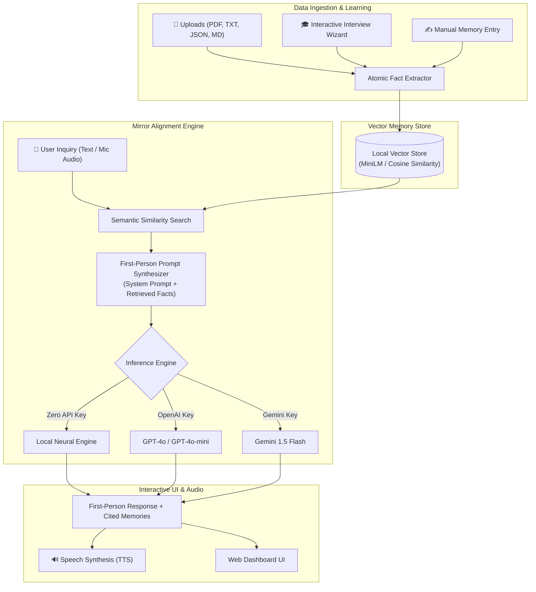

# 🪞 MirrorGPT — Autonomous AI Digital Twin & Personal Alignment Engine

[](https://www.python.org/downloads/)
[](https://fastapi.tiangolo.com)
[](https://www.docker.com)
[](https://opensource.org/licenses/MIT)

> **MirrorGPT** is an autonomous AI agent engine that learns your personal background, speaking style, knowledge, and voice to act and communicate on your behalf as your authentic AI "Digital Twin".

---

## 🚀 Key Features

* **🗣️ First-Person Personal AI Alignment**: Speaks strictly in the first person (`"I"`, `"my"`, `"myself"`), emulating the subject's exact knowledge and communication style.
* **📚 Semantic Knowledge Bank (RAG)**: Ingests Resumes, LinkedIn exports, personal notes, PDFs, and JSON files, automatically extracting and indexing atomic facts via vector embeddings.
* **🎙️ Voice Input & Speech Synthesis**:
  * Hands-free voice chat via built-in Web Speech API (zero external keys needed).
  * Text-to-speech audio playback on every response.
  * Optional ElevenLabs voice cloning integration.
* **🎓 Interactive "Teach Me" Interview Studio**: A conversational interview wizard where the AI interviews you to dynamically extract and store your background, projects, skills, and philosophies.
* **⚡ Multi-Model & Offline Zero-Key Demo Mode**:
  * **Local Neural Engine**: Works 100% offline out-of-the-box without requiring any paid API key!
  * **OpenAI Integration**: `gpt-4o-mini` and `gpt-4o`.
  * **Google Gemini Integration**: `gemini-1.5-flash`.
* **💻 Modern Glassmorphism Web Interface**: Built with FastAPI, Tailwind CSS, and Lucide icons featuring live chat, document dropzone, memory manager, and persona customizer.

---

## 🏛️ System Architecture



---

## ⚡ Quickstart

### 1. Clone & Install Dependencies
```bash
git clone <your-repo-url>
cd MirrorGPT

# Create virtual environment
python -m venv .venv

# Activate environment (Windows)
.venv\Scripts\activate
# Activate environment (Mac/Linux)
source .venv/bin/activate

# Install requirements
pip install -r requirements.txt
```

### 2. Launch the Web Application
```bash
python web_app.py
```
Open **[http://localhost:8000](http://localhost:8000)** in your browser!

---

## 🌐 Deploy & Host (Free Public URL for Judges)

### Option 1: Hugging Face Spaces (Recommended — Permanent & Free)
1. Go to [Hugging Face Spaces](https://huggingface.co/spaces) and click **Create new Space**.
2. Space SDK: Select **Docker** (Blank).
3. Connect your GitHub repository or push this repository directly:
   ```bash
   git remote add space https://huggingface.co/spaces/<your-username>/MirrorGPT
   git push space main
   ```
4. Hugging Face will automatically build the `Dockerfile` and provide a permanent public link:  
   `https://<your-username>-mirrorgpt.hf.space`

### Option 2: Render.com (1-Click Free Hosting)
1. Push this repo to your GitHub account.
2. Sign in to [Render.com](https://render.com) and create a **New Web Service**.
3. Select your repository. Render automatically reads `render.yaml` and deploys your service.
4. You will receive a live URL: `https://mirrorgpt.onrender.com`.

### Option 3: Instant Local Tunnel (Demo from your PC)
Run the web app in one terminal, and in another run:
```bash
npx localtunnel --port 8000
```
This gives you an instant public HTTPS link to share immediately.

---

## 🛠️ CLI Mode (Optional)

If you prefer terminal interaction:
```bash
# Chat with default persona
python mirror/entrypoints/run_mirror.py -n "Piyush" -p piyush

# Teach your mirror interactively via terminal
python mirror/entrypoints/teach_mirror.py -n "YourName"
```

---

## 📄 License
This project is licensed under the [MIT License](LICENSE).
